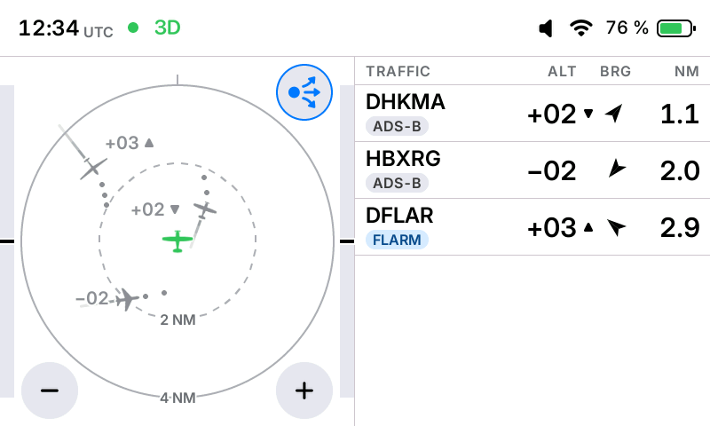
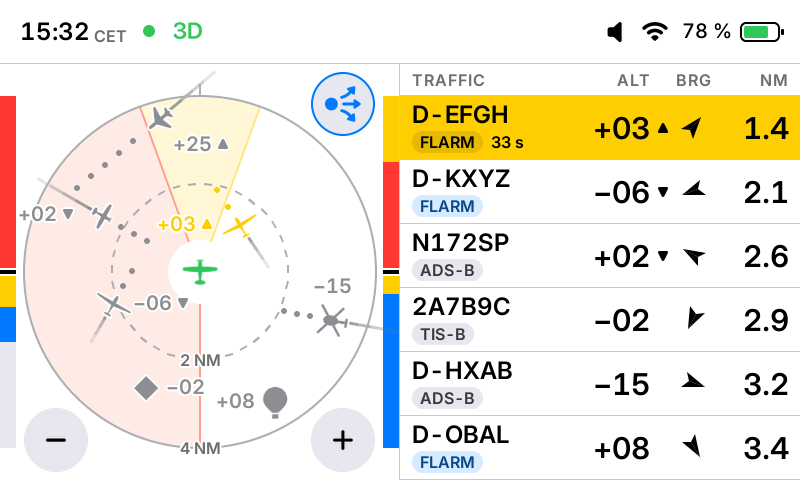
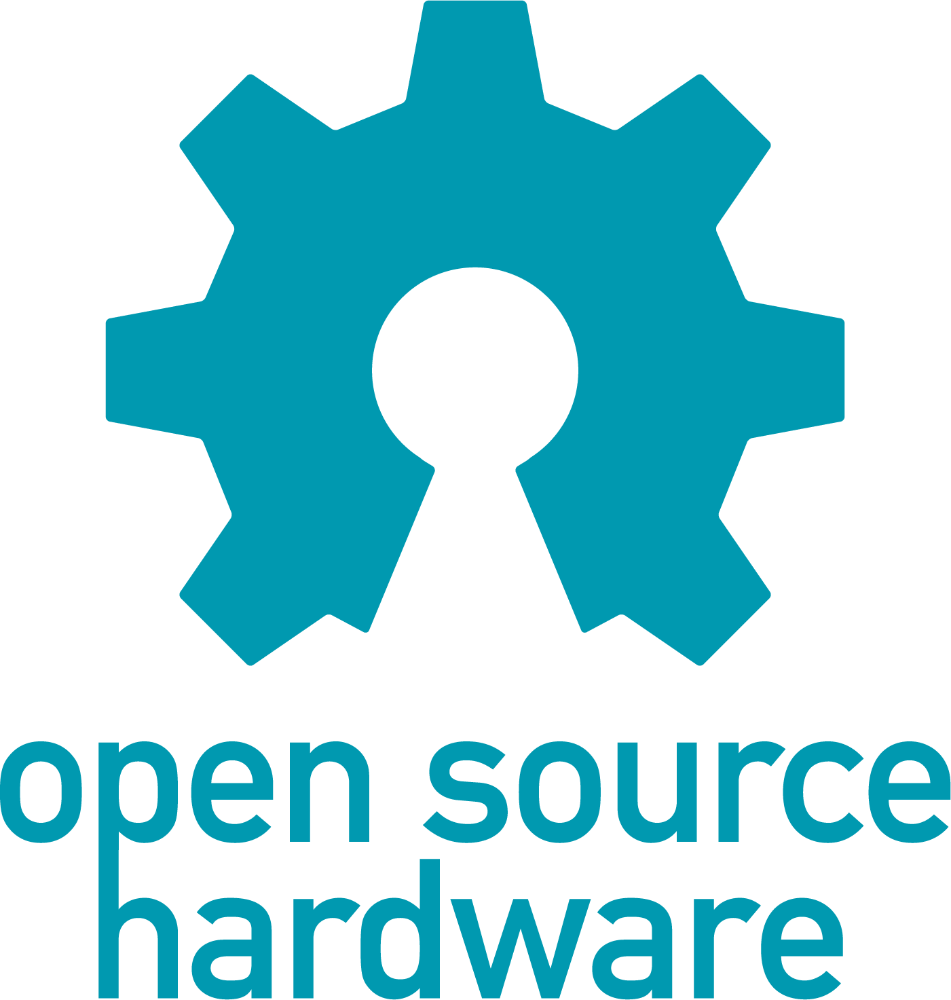

++++
<h1>
<picture>
<source media="(prefers-color-scheme: dark)" srcset="assets/logo-dark@2x.png">

</picture>
</h1>
++++

A portable ADS-B / FLARM receiver based on https://github.com/PantsForBirds/adsbee[ADSBee].
Started as carrier board for a removable ESP32-S3 touch display and https://pantsforbirds.com/product/adsbee-1090u/[ADSBee 1090U] receiver, with a soldered MAX-M10S GNSS receiver.
It adds a single-cell Li-ion charger, a 5 V boost rail, a fuel gauge, a barometer and a buzzer.

.airgrep Screenshot

.Traffic Advisory

== Features

* 800x480 Capacitive Touchscreen with ESP32 S3 microcontroller (240 MHz, 16 MB Flash, 8 MB PSRAM)
* https://github.com/PantsForBirds/adsbee[ADSBee 1090U] ADS-B receiver with FLARM firmware and GDL90 Broadcast of FLARM traffic (for e.g. Skydemon, Foreflight, …) via WiFi
* https://www.u-blox.com/en/product/max-m10-series[GPS Module], https://www.bosch-sensortec.com/en/products/environmental-sensors/pressure-sensors/bmp580[Pressure Sensor (for barometric Altitude)]
* link:https://github.com/mp911de/daidalus[DAIDALUS] Traffic Advisory engine (Detect and AvoID)
* Buzzer, WiFi (via ADSBee), USB-C Charging Port, Rechargeable Li-Ion Battery
* `airgrep.py` and `airgrep Utility` apps for firmware and device management

=== Ideas for the next revision

* IMU (Accelerometer, Gyro) for Foreflight's AHRS
* USB Switch for easier Firmware upgrades
* Remote Light Sensor for Display brightness control
* https://pantsforbirds.com/adsbee/#adsbee-1421[ADSBee m1421] Module (smaller and cheaper)

== Current state

* [x] Rev A board works
* [ ] Firmware: In progress
** [x] Basic charger and component connectivity
** [x] ADSbe Firmware: Adopted (https://github.com/mp911de/adsbee/tree/flarm)
** [ ] Flarm barometric altitude normalization
* [ ] Planning for Rev B

== Pointers

[width="100%",cols="50%,50%",options="header",]
|===
|Path |Content
|docs/ |Specs, design decisions, mechanics, pin maps, I2C limits,
firmware requirements, USB protocol, hand-sourced BOM, open issues

|issues/ |Local issue tracker, one file per issue

|specs/ |Power model inputs behind the tables in `docs/specs.adoc`

|hardware/ |KiCad projects: `carrier-ti-charger` (active, BQ25798, with
schematic PDF and JLCPCB exports), `carrier-max-charger` (frozen
reference), `insulator`, `sim`

|firmware/ |Display firmware and utility app

|datasheets/ |Data sheets of the parts in use
|===

== License

This project (hardware design and software) is licensed under the link:LICENSE.txt[Apache License 2.0] except where noted.

Firmware builds and the device include third-party components under their own licenses, listed on the device under Licenses and in `firmware/utility/remote/notices/`.
These include:

* https://github.com/mp911de/daidalus[DAIDALUS], NASA Open Source Agreement 1.3
* https://github.com/mp911de/adsbee/tree/flarm[ADSBee firmware] GPL-3.0 (running on the ADSBee receiver with link:https://www.flarm.com/en/integration/flarm-famp-public-protocol/[FLARM FAMP])
