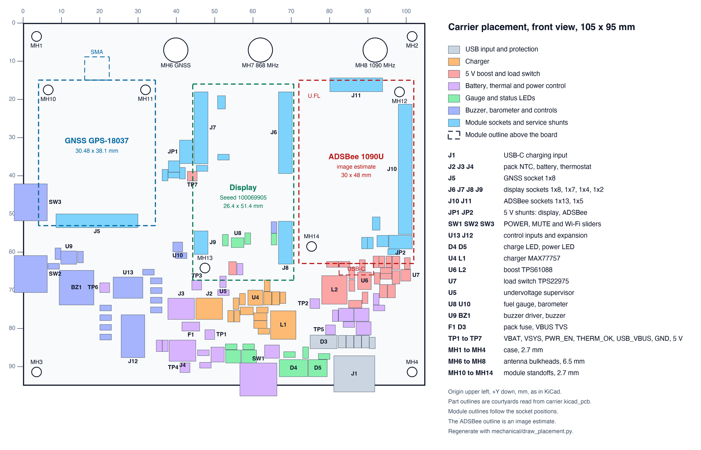

# Mechanical

Board outline, placement, mounting and the stack behind the display. Headline figures are in [specs.md](specs.md), connectors and pin maps in [interfaces.md](interfaces.md), hand-fitted parts in [bom-hand-sourced.md](bom-hand-sourced.md).

## Placement



The drawing is generated from `hardware/kicad/carrier.kicad_pcb`, which is the source for every position. Regenerate it after moving parts, from the repository root, with KiCad's Python:

```
tools/kpy mechanical/draw_placement.py
```

It writes `mechanical/placement.svg` and `mechanical/placement.png`. Coordinates are KiCad millimetres: front view, origin upper left, X right, Y down.

The board is 105 x 95 mm. The 100 x 60 x 11 mm battery behind it sets the minimum size.

Placement rules:

- RF sits at the top: the GNSS module, the ADSBee and the three antenna mounts.
- Both switching converters sit at the bottom right. The charger inductor L1 is about 37 mm from the GNSS module outline, the boost inductor L2 about 42 mm.
- POWER slider SW1, LEDs D4 and D5 and the USB-C receptacle J1 line up on the bottom edge and face down. Side clearance in an aircraft is often poor.
- MUTE slider SW2 is on the left edge, next to the buzzer. Wi-Fi slider SW3 is above it on the same edge.
- The display sits in the middle column, glass to the front.
- The pack connectors J2, J3, J4 and the pack fuse F1 are at the bottom, left of centre, reachable with the rear cover off.
- Shunt JP1 is left of the display and stays reachable with the display fitted. JP2 lies under the lower right corner of the ADSBee outline.
- The antenna mounts are MH6 (GNSS), MH7 (868 MHz) and MH8 (1090 MHz). MH6 is 20.6 mm from the GNSS SMA axis at x = 19.3, so an SMA adapter or a short lead fits.
- The ADSBee is portrait, 30 x 48 mm. Its own USB-C faces down, above the boost converter. Its U.FL connectors are at the upper left corner.

Module outlines in the drawing follow the socket positions. The GNSS and display outlines come from the manufacturer CAD (`mechanical/source-geometry.json`), the ADSBee outline from an image estimate ([adsbee-estimate.md](../mechanical/adsbee-estimate.md)).

### Control sliders

SW1 to SW3 use HRO K3-1280S-F1, C92658, with the local `carrier:SW-SMD_K3-1280S-F1` footprint. It follows the [manufacturer drawing](../datasheets/hro-k3-1280s.pdf): 2.50 mm terminal pitch, 1.20 x 2.45 mm solder lands, two 0.90 mm holes spaced 6.80 mm, and 3.075 mm from the terminal-row centre to the peg line. The body is 9.10 x 3.50 mm in that drawing, 3.50 mm high, with a 2 mm F1 actuator and 2 mm travel.

Footprint origins are the middle terminal. Board coordinates are integer mil:

| Ref | X | Y | KiCad rotation | Access |
|---|---|---|---|---|
| SW1 | 2420 | 3567 | 0 degrees | bottom |
| SW2 | 190 | 2590 | 270 degrees | left |
| SW3 | 190 | 1850 | 270 degrees | left |
| J12 pin 1 | 1080 | 3080 | 0 degrees | front, inside enclosure |

SW2 and SW3 bodies end approximately at the left board edge; their actuators extend about 79 mil beyond it. SW1's body overhangs the lower edge by about 17 mil, with a further 79 mil actuator extension. This keeps its new courtyard clear of the existing circuitry. Include the full actuator travel and housing tolerance when designing the case.

The supplier CAD has inconsistent F2/K1 names and a different peg offset. Use the manufacturer-derived footprint, and check an actual F1 sample and the JLCPCB assembly preview before ordering. No verified F1 3D model is assigned. See [physical controls](../workflows/physical-controls.md) for the comparison.

### USB-C receptacle in the case

J1 is mounted so that the shell front extends 1.2 mm past the board edge. The front shell tabs stay about 0.5 mm inside the edge.

Place the board edge about 0.5 mm inside the case wall. With a 1.5 to 2 mm wall the receptacle face ends 0.3 to 1.3 mm behind the outer surface, which a USB-C plug reaches. Chamfer the opening.

## Assembly split

- JLCPCB assembles all SMD parts. They are on the top side.
- Hand-soldered through-hole parts: module sockets J5 to J11, pack connectors J2 to J4, shunt headers JP1 and JP2, expansion header J12, LEDs D4 and D5. The parts are listed in [bom-hand-sourced.md](bom-hand-sourced.md).
- All seven module sockets are 2.54 mm single-row female headers of one height, 8.5 mm.

## Mounting

All mounting hardware is M2.5. The carrier has nine 2.7 mm non-plated holes (KiCad stock `MountingHole_2.7mm_M2.5`) and three 6.5 mm antenna holes (stock `MountingHole_6.5mm`).

| Use | References | Centres (X, Y) in mm | Basis |
|---|---|---|---|
| Case | MH1, MH2, MH3, MH4 | (3.556, 3.556), (101.600, 3.556), (3.556, 91.440), (101.600, 91.440) | 3.40 to 3.56 mm from the edges |
| GNSS | MH10, MH11 | (6.600, 17.531), (32.014, 17.520) | SparkFun GPS-18037 holes H2 and H1, within 0.012 mm of the module CAD |
| Display | MH13 | (47.511, 64.195) | Seeed 100069905 hole H1, within 0.029 mm of the module CAD |
| ADSBee | MH12, MH14 | (98.301, 18.097), (75.321, 58.561) | image estimate, see below |
| Antenna bulkheads | MH6, MH7, MH8 | (39.878, 7.112), (61.976, 7.112), (91.948, 7.112) | 6.5 mm hole, 11 mm keepout |

Notes on the module holes:

- GNSS: the two holes next to J5 are not drilled. They would sit 1.3 mm from the header row, and the header carries that edge.
- Display: the other three module holes, at (67.53, 64.17), (67.53, 41.67) and (47.53, 41.67), are not drilled. The display rests on its four socket groups and the one standoff. The module CAD has 2.5 mm holes.
- ADSBee: MH12 and MH14 are a diagonal pair on the 23.0 x 40.5 mm pattern of the manufacturer enclosure STEP. They sit 0.20 mm and 0.58 mm from the centres of the image estimate, inside its 0.5 mm planning allowance only for MH12.
- Module standoffs are 8.5 mm nominal to match the sockets. Case standoff height depends on the enclosure.

Clearance around the 2.7 mm holes on the current board:

- No copper other than GND within 3 mm of any hole centre, with one exception: a GNSS_TXO track on F.Cu ends 2.66 mm from the MH11 centre, under solder mask. A 5 mm hex standoff reaches 2.89 mm at its corners, so use a round standoff or a nylon washer there.
- The nearest courtyards are J10 at 3.2 mm from MH12, J9 at 3.6 mm from MH13 and J8 at 5.0 mm from MH14.
- `carrier.kicad_dru` keeps copper clear of the holes.

## Insulator board

A plain board between the carrier and the battery keeps the through-hole pin tails off the pack. It is a separate KiCad project, `hardware/insulator/insulator.kicad_pcb`, generated from the carrier by `tools/make_insulator.py`.

| Property | Value |
|---|---|
| Outline | same as the carrier |
| Material | 0.8 mm FR-4, no copper |
| Case holes | MH1 to MH4, copied from the carrier |
| Antenna clearance | 11 mm holes at MH6 to MH8 for the bulkhead nuts and pigtails |
| Cable slot | 15 x 7.5 mm with round ends, centred at (45.1, 80.9), between J2/J3 and J4 |
| Silkscreen | J2, J3, J4 outlines on the carrier side, BATTERY SIDE on the other |

Order it as a separate board in the same JLCPCB cart. It cannot share the four-layer panel.

The standoffs between carrier and insulator must clear the longest pin tail. Trim the hand-soldered tails to about 1.5 mm and use M2.5 spacers of at least 3 mm.

J2, J3 and J4 may go on either side of the carrier; both sides are labelled ([interfaces.md](interfaces.md#silkscreen-labels)). The prototype keeps them on top, with the leads around the board edge. On the back they need a larger gap: about 6 mm for the PH housing plus the mated plug. The slot size is a first guess; it is set by SLOT_W and SLOT_H in the generator.

## Stack

From front to back:

1. Front cover with openings for the screen and the buttons, independent of the display.
2. Modules on their sockets.
3. Carrier board.
4. Spacers and insulator board.
5. Battery, supported by the case.
6. Rear cover.

## Open checks

Mechanical checks that still need the delivered modules or the enclosure are listed in [open-issues.md](open-issues.md).
