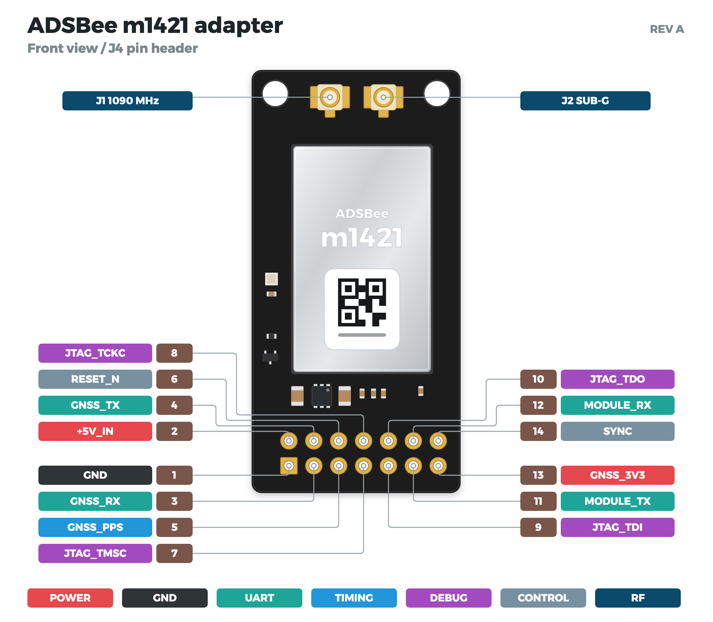
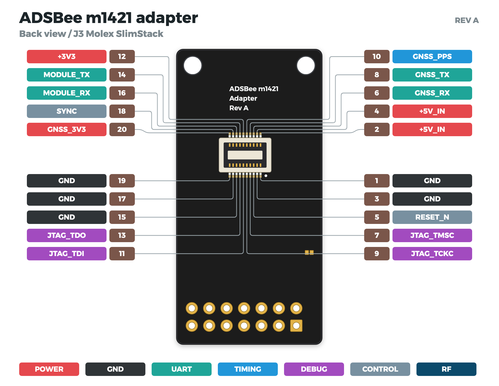

# ADSBee m1421 Breakout Board

## Pinout

| Front, J4 pin header | Back, J3 Molex 54722-0204 |
| --- | --- |
|  |  |
| Square pad 1 is at lower left. | Pin 1 is at lower right, beside the silkscreen dot. |

Both views face the adapter with the mounting holes at the top.

| Signal | J4 | J3 | Module pin (U1) | Description |
| --- | --- | --- | --- | --- |
| +5V_IN | 2 | 2, 4 | | 5 V input to the onboard 3.3 V regulator. |
| +3V3 | | 12 | 1, 4, 19, 22 | Unswitched 3.3 V output from the onboard regulator. |
| GND | 1 | 1, 3, 15, 17, 19 | 6, 18, 23, 25, 27, 34, 36, MP | Power and signal return. |
| GNSS_RX | 3 | 6 | 13 | GNSS UART receive. |
| GNSS_TX | 4 | 8 | 12 | GNSS UART transmit. |
| GNSS_PPS | 5 | 10 | 14 | Pulse per second from the GNSS receiver. |
| RESET_N | 6 | 5 | 17 | Drive low to reset the module. |
| JTAG_TMSC | 7 | 7 | 8 | cJTAG data and control, JTAG TMS. |
| JTAG_TCKC | 8 | 9 | 9 | Debug clock. |
| JTAG_TDI | 9 | 11 | 11 | JTAG data input. |
| JTAG_TDO | 10 | 13 | 10 | JTAG data output. |
| MODULE_TX | 11 | 14 | 21 | Module output to host RX. |
| MODULE_RX | 12 | 16 | 20 | Module input from host TX. |
| GNSS_3V3 | 13 | 20 | | Switched 3.3 V output. DIO27 low enables Q1. Bridge JP1 for always-on power. |
| SYNC | 14 | 18 | 28 | High requests sleep, or selects the bootloader at reset. |

Signal levels are 3.3 V. Use one driver per signal shared by J4 and J3.

## Firmware updates

The module updates over its UART ROM bootloader on MODULE_RX and MODULE_TX.

1. Drive SYNC high.
2. Pulse RESET_N low and release it while SYNC stays high.
3. Flash over the UART.
4. Return SYNC low and reset to run the application.

The application console runs at 1 Mbaud by default. JTAG is available on both connectors for recovery. The updater or debug probe is external to this board.

## Links

- [ADSBee m1421 hardware documentation](https://github.com/PantsForBirds/adsbee/blob/main/docs/adsbee-1421/m1421.md)
- [ADSBee 1421 firmware README](https://github.com/PantsForBirds/adsbee/blob/main/firmware/adsbee_1421/README.md)
- [Molex SlimStack family data](https://www.molex.com/content/dam/molex/molex-dot-com/en_us/pdf/datasheets/987652-3791.pdf). J3: 54722-0204, the mating plug is 55560-0207.
